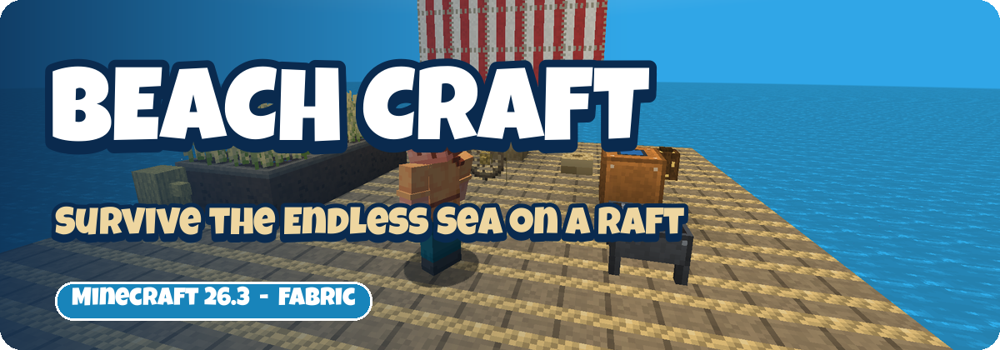
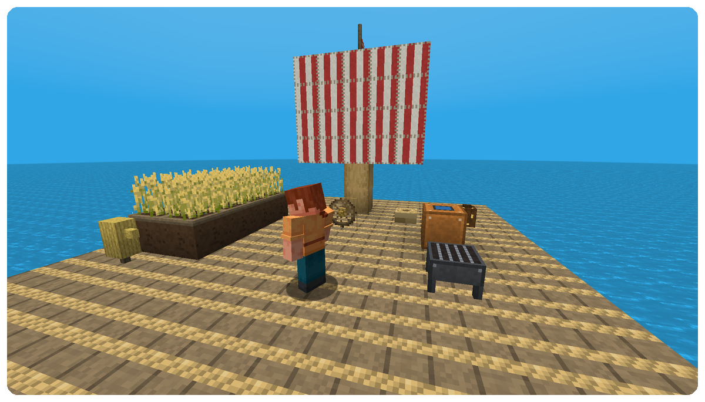
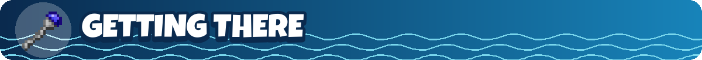
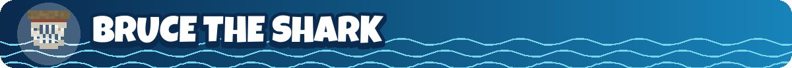
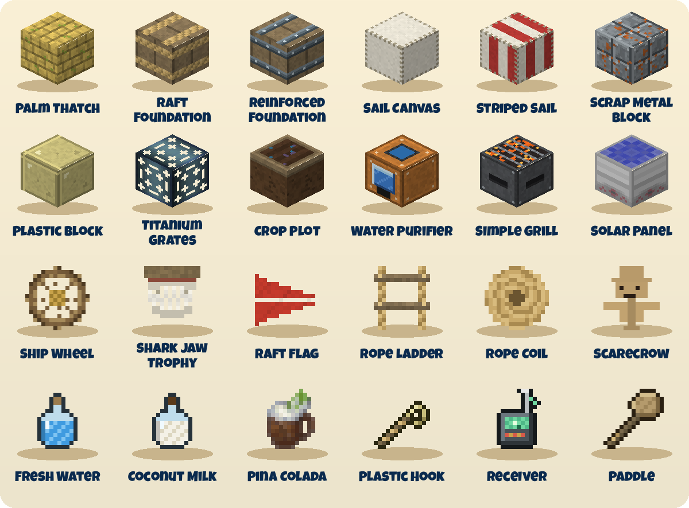

   

**Beach Craft** brings the open-sea survival of the game *Raft* into Minecraft. Build a driftwood portal, step through - and you are on a tiny platform in an endless ocean. Debris drifts past, a shark circles your feet, and every plank you fish out of the water makes your raft a little bigger. Purify your water, grill your fish, farm on floating crop plots and follow the receiver to islands full of old wrecks.

Have an idea for the sea? Tell me on [Discord](https://discord.com/invite/zuZVtVvJaY).

The **Raft dimension** is one huge ocean with drifting islands, palm trees and titanium under the sea floor. Every few seconds the current carries **debris** past you: planks, palm leaves, plastic, scrap metal and now and then a barrel with loot. Grab it with the **Plastic Hook** (hold right-click) or let an **Item Catcher** do the work.

1. Look for **Ancient Broken Rings** in shipwreck treasure, buried treasure and ocean ruins (or fish for them) and smelt them into **Ancient Energy**.
2. Shipwreck treasure also holds **Ancient Crystals**. Crystal + energy + stick = **Energy Staff**.
3. Bleached **driftwood** trees grow on beaches. Four driftwood logs around one ancient energy make **4 Portal Frames**.
4. Build the frame like a nether portal and light it with the staff. You arrive on a driftwood platform high above the waves - with a portal back home.

Prefer to skip the walk? The **Raft Teleporter** takes you straight to the sea.

- **Raft Foundations** - planks bound with rope; reinforced foundations for the stormy days
- **Rope** - from palm leaves or string; rope ladders you can climb, rope coils for decoration
- **Water Purifier** - turns water bottles into **Fresh Water** (a bucket gives three)
- **Simple Grill** - cooks two foods at once, 50% faster than a campfire
- **Crop Plot** - farmland that is always watered and never trampled, and crops grow faster on it
- **Scarecrow** - no hostile mob spawns within 24 blocks, no trampled crops within 8
- **Drinks** - Fresh Water, Coconut Milk (Regeneration) and the legendary Piña Colada

**Bruce** is back. The shark hunts anyone who swims in the raft ocean. Beat him for **shark meat** and **shark teeth** - and hang his jaw on your wall as a **trophy**.

- **Receiver** - right-click to see the direction and distance to the nearest island
- **Paddle** - right-click in a boat for a push forward
- **Metal Detector** - right-click the ground and it tells you the first valuable ore below
- **Titanium** - ore under the sea floor; tools and armor with special effects
- **Music** - three ocean music discs hide in shipwrecks

The sea has its own small tech line: **Makeshift Solar Panels** (10 FE/t), a **Makeshift Battery** (1,000,000 FE), copper and titanium **cables**, an 11x11 **Quarry** and the **Chunk Destroyer**. They speak the Team Reborn Energy API, so Tech Reborn machines plug right in.

Driftwood and palm wood sets, palm thatch (blocks, stairs, slabs), sail canvas (plain and red-striped), a ship wheel, the raft flag, coconut lanterns, plastic and scrap metal blocks, titanium grates - everything you need for a raft that looks like home.

---

Beach Craft is part of the **[Dreamcraft](https://www.curseforge.com/minecraft/modpacks/dreamcraft-new)** modpack, where a whole quest chapter guides you across the Endless Sea. Want to play with friends? [BisectHosting](https://bisecthosting.com/kasax007) - code **KASAX007** for 25% off.
